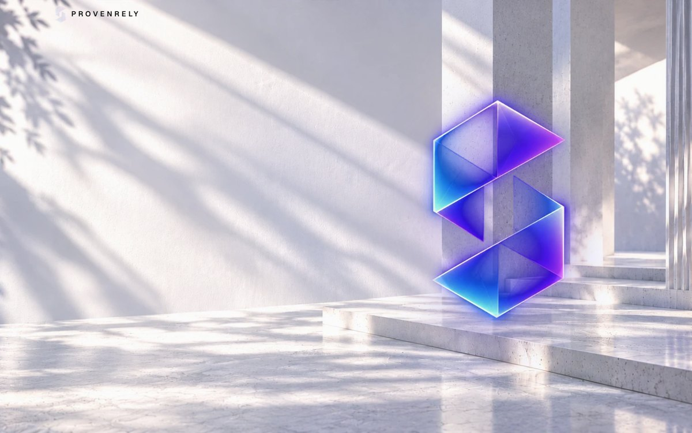
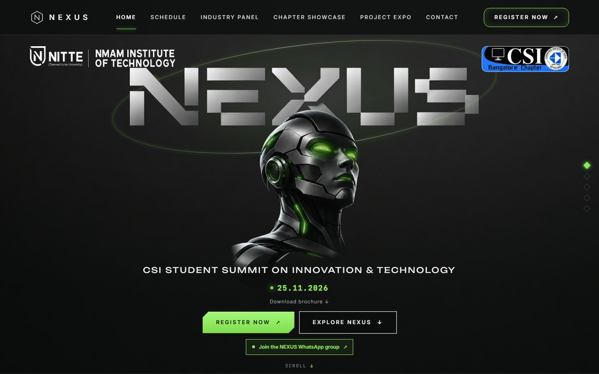
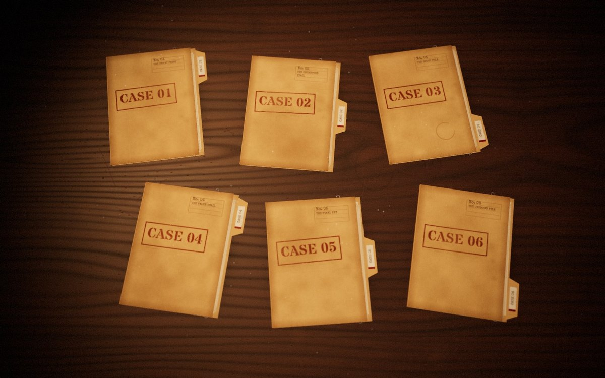
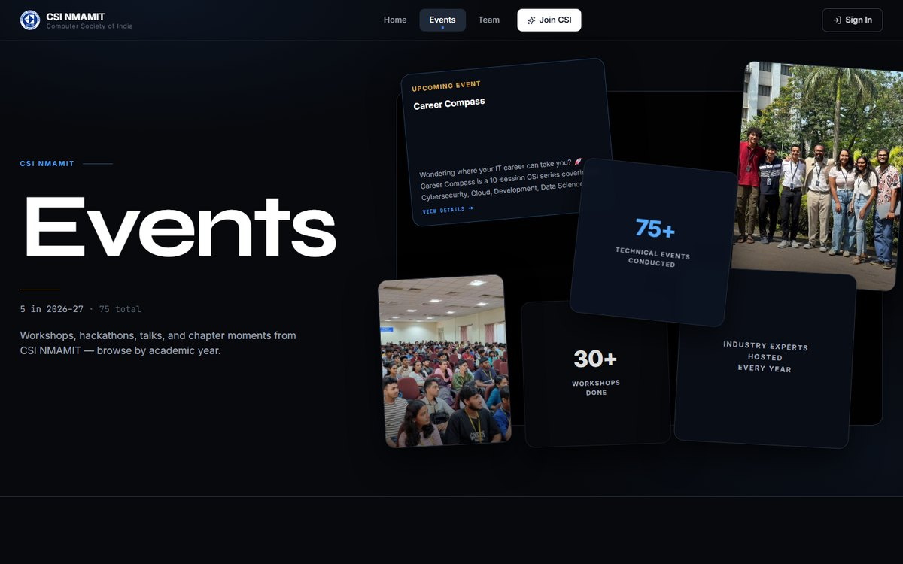
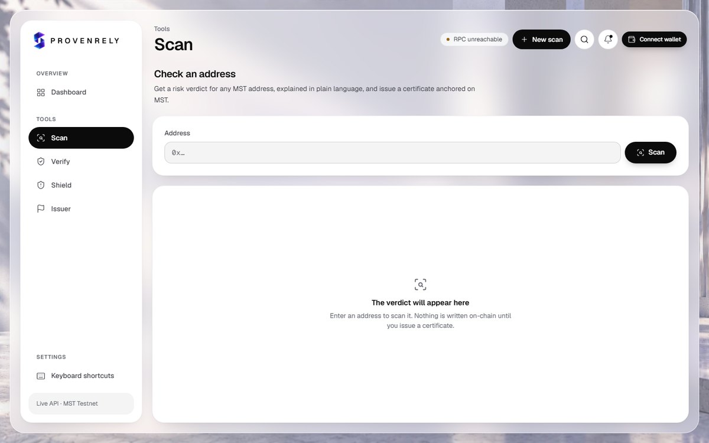
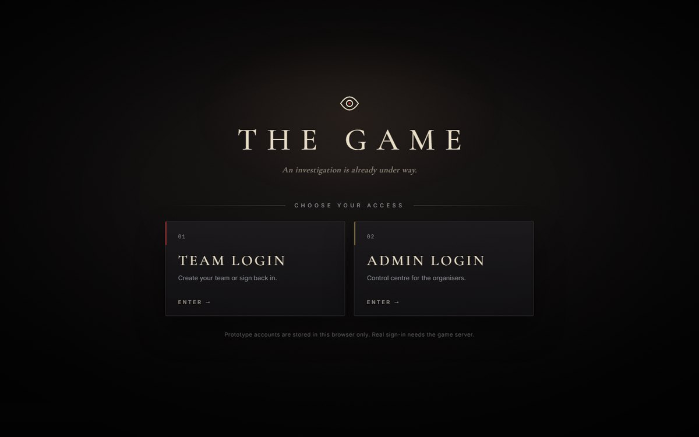

<!-- ═══════════════════════════════  HERO  ═══════════════════════════════ -->

  

  <b>Neil Malvalli</b> &nbsp;·&nbsp; B.Tech Computer Science Engineering, NMAMIT
   
  Cybersecurity &nbsp;◆&nbsp; Cloud Security &nbsp;◆&nbsp; Full-Stack &nbsp;◆&nbsp; Blockchain &nbsp;◆&nbsp; UI/UX

  
  <!-- TODO: replace YOUR-LINKEDIN-HANDLE with your LinkedIn handle -->
  
  <!-- TODO: replace YOUR-EMAIL@example.com with the address you want public -->
  

<!-- ═══════════════════════════════  ABOUT  ═══════════════════════════════ -->

<h2>▸ ABOUT ME</h2>

Hey! I'm **Neil Malvalli**, a computer science student and developer who likes building secure, scalable and visually engaging applications.

I work where **cybersecurity, cloud infrastructure, blockchain and software development** meet. Alongside engineering, I care a lot about **UI/UX design**: interfaces that feel intuitive, and motion that has a purpose. Long term, I'm working towards **Cloud Security Architecture**.

<table>
  <tr>
    <td width="50%" valign="top">
      <b>Currently exploring</b> 
      Cloud Security, AWS Architecture and Application Security
    </td>
    <td width="50%" valign="top">
      <b>Currently building</b> 
      Security-focused applications and full-stack projects
    </td>
  </tr>
  <tr>
    <td width="50%" valign="top">
      <b>Interested in</b> 
      Cloud Infrastructure, Blockchain, System Design and UI/UX
    </td>
    <td width="50%" valign="top">
      <b>Creative side</b> 
      Interface design, animations and interactive experiences
    </td>
  </tr>
</table>

<!-- ═══════════════════════════════  PROJECTS  ═══════════════════════════════ -->

<h2>▸ FEATURED PROJECTS</h2>

<table>
  <tr>
    <!-- ── PROVENRELY ── -->
    <td width="50%" valign="top">
      
      <h3 align="center">Provenrely</h3>
      

        Check a crypto address <i>before</i> you pay, then prove what you found.
        A blockchain platform that fights crypto scams in three layers:
      

      <ul>
        <li><b>Shield</b>: an on-chain flagged-wallet registry. <code>SafeSend</code> reverts any transfer to a flagged address.</li>
        <li><b>Certificate</b>: scan verdicts sealed into tamper-proof evidence certificates whose hashes are anchored on-chain and verified in the browser.</li>
        <li><b>Custody</b>: every share or export of a certificate is logged on-chain.</li>
      </ul>
      

        
        
        
        
        
        
        
      

      

        <a href="https://github.com/neilmalvalli-cyber/Provenrely"><b>Repository</b></a> &nbsp;·&nbsp;
        <a href="https://frontend-pink-gamma-26.vercel.app"><b>Live demo ↗</b></a>
      

    </td>
    <!-- ── NEXUS ── -->
    <td width="50%" valign="top">
      
      <h3 align="center">NEXUS 2026</h3>
      

        The website and registration system for <b>NEXUS 2026</b>, the CSI Student Summit on Innovation &amp; Technology at NMAMIT.
        A charcoal-and-neon visual identity carried from a cinematic intro through the whole site.
      

      <ul>
        <li>Skippable <b>intro animation</b> that plays once per session and respects reduced-motion.</li>
        <li><b>Seven-step registration form</b> with draft saving and validation that mirrors the server.</li>
        <li><b>Organiser dashboard</b> to search, verify, edit, review expo entries and export CSV.</li>
      </ul>
      

        
        
        
        
        
        
        
      

      

        <a href="https://github.com/neilmalvalli-cyber/NEXUS"><b>Repository</b></a> &nbsp;·&nbsp;
        <a href="https://nexus-2026-wine.vercel.app"><b>Live site ↗</b></a>
      

    </td>
  </tr>
  <tr>
    <!-- ── THE GAME ── -->
    <td width="50%" valign="top">
      
      <h3 align="center">THE GAME</h3>
      

        A 3D team investigation game. Six case files sit on a detective's desk, and solving them assembles
        the code to a locked phone. Teams spend coins in a Normal Market and a Black Market on power-ups and sabotage.
      

      <ul>
        <li>A <b>three.js</b> desk scene with GSAP-driven camera moves and an incoming-call intro.</li>
        <li>Power-ups and rival sabotage: Skip Token, Master Key, Firewall, Glitch Attack, Freeze.</li>
        <li>All rules run in <b>atomic SQL functions</b> on Supabase: answers are checked on the server, RLS is on, and double-spends are blocked.</li>
      </ul>
      

        
        
        
        
        
        
        
      

      

        <a href="https://github.com/neilmalvalli-cyber/THE_GAME"><b>Repository</b></a>
      

    </td>
    <!-- ── CSI NMAMIT ── -->
    <td width="50%" valign="top">
      
      <h3 align="center">CSI NMAMIT Website</h3>
      

        The official website of the Computer Society of India student chapter at NMAMIT. I worked on
        <b>frontend development and UI/UX</b>.
      

      <ul>
        <li>Events, team and membership pages with motion-driven layouts.</li>
        <li>Google sign-in via Firebase; PostgreSQL is the source of truth for roles, profiles and registrations.</li>
        <li>Event registration and membership payments through Razorpay, with media in S3-compatible storage.</li>
      </ul>
      

        
        
        
        
        
        
        
        
        
      

      

        <a href="https://csinmamit.in"><b>Live site ↗</b></a> &nbsp;·&nbsp;
        <i>Source is in a private organisation repository</i>
      

    </td>
  </tr>
</table>

<!-- ═══════════════════════════════  UI/UX  ═══════════════════════════════ -->

<h2>▸ UI/UX SHOWCASE</h2>

I enjoy the design half of the work as much as the engineering: building visual identities, laying out dashboards, and adding motion and micro-interactions.

<table>
  <tr>
    <td width="33%" valign="top">
      
      
<b>Visual identity</b> NEXUS charcoal-and-neon landing

    </td>
    <td width="33%" valign="top">
      
      
<b>Dashboard design</b> Provenrely frosted-glass app shell

    </td>
    <td width="33%" valign="top">
      
      
<b>Atmospheric UI</b> THE GAME noir access screen

    </td>
  </tr>
</table>

  
  
  
  
  

<!-- TODO: add your Figma profile or design portfolio link here, e.g.

-->

<!-- ═══════════════════════════════  TECH STACK  ═══════════════════════════════ -->

<h2>▸ TECH STACK</h2>

<table>
  <tr>
    <td width="22%"><b>Languages</b></td>
    <td></td>
  </tr>
  <tr>
    <td><b>Frontend</b></td>
    <td></td>
  </tr>
  <tr>
    <td><b>Backend</b></td>
    <td></td>
  </tr>
  <tr>
    <td><b>Databases</b></td>
    <td></td>
  </tr>
  <tr>
    <td><b>Cloud &amp; Security</b></td>
    <td>
      
      &nbsp;
      
      
      
    </td>
  </tr>
  <tr>
    <td><b>Design</b></td>
    <td>
      
      &nbsp;
      
    </td>
  </tr>
  <tr>
    <td><b>Tools</b></td>
    <td></td>
  </tr>
</table>

<!-- ═══════════════════════════════  LEARNING  ═══════════════════════════════ -->

<h2>▸ CURRENTLY LEARNING</h2>

  
  
  
  
  
  
  
  

<!-- ═══════════════════════════════  ACHIEVEMENTS  ═══════════════════════════════ -->

<h2>▸ EXPERIENCE &amp; ACTIVITIES</h2>

<table>
  <tr>
    <td width="33%" valign="top">
      
<b>Leadership</b>

      <ul>
        <li>Tech Team Co-Head, <b>CSI NMAMIT</b> (2026–27)</li>
      </ul>
    </td>
    <td width="33%" valign="top">
      
<b>Coursework</b>

      <ul>
        <li>AWS Cloud Practitioner Essentials</li>
        <li>AWS Networking Basics</li>
        <li>Microsoft Azure learning paths</li>
      </ul>
    </td>
    <td width="33%" valign="top">
      
<b>Activities</b>

      <ul>
        <li>Hackathon participation</li>
        <li>CTF participation</li>
        <li>Security-focused project development</li>
      </ul>
    </td>
  </tr>
</table>

<!-- ═══════════════════════════════  ANALYTICS  ═══════════════════════════════ -->

<h2>▸ GITHUB STATS</h2>

  
  

  

  

<!-- ═══════════════════════════════  CONNECT  ═══════════════════════════════ -->

<h2 align="center">▸ CONNECT WITH ME</h2>

  
  &nbsp;
  <!-- TODO: replace YOUR-LINKEDIN-HANDLE -->
  
  &nbsp;
  <!-- TODO: replace YOUR-EMAIL@example.com -->
  
  <!-- Portfolio: add later, e.g.
  &nbsp;
  
  -->

Ember and Tide are original characters. Thanks for stopping by. ◆ <b>INSERT COIN</b> to play again.

